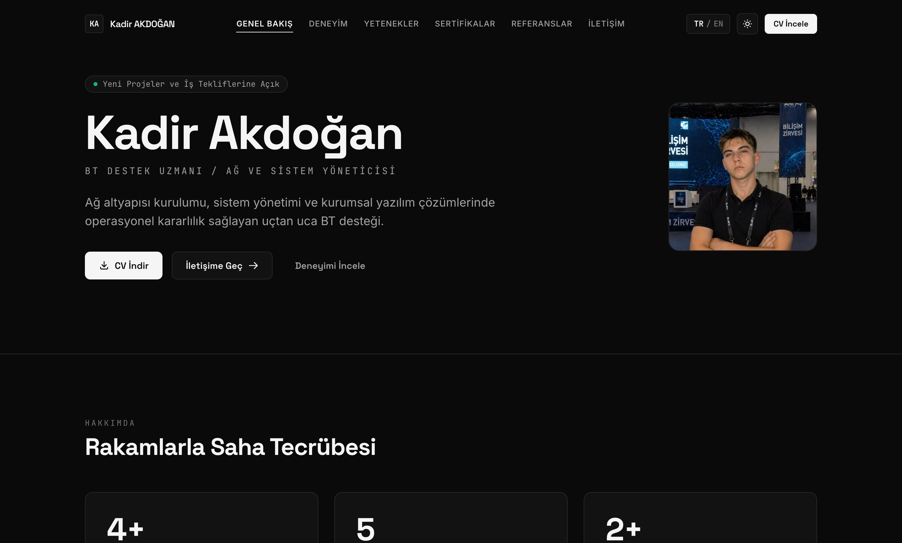
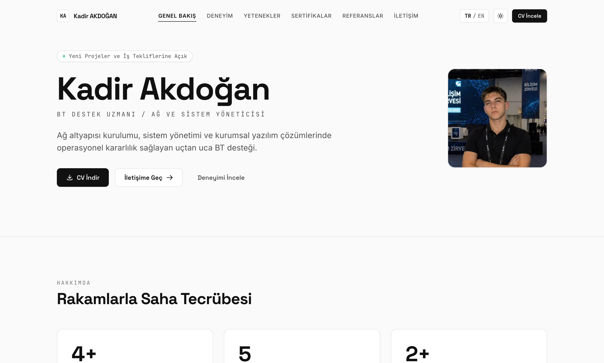
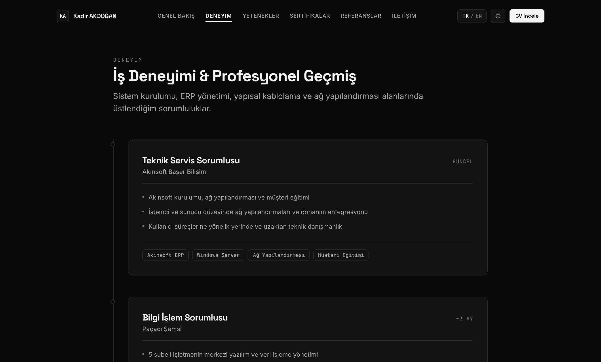
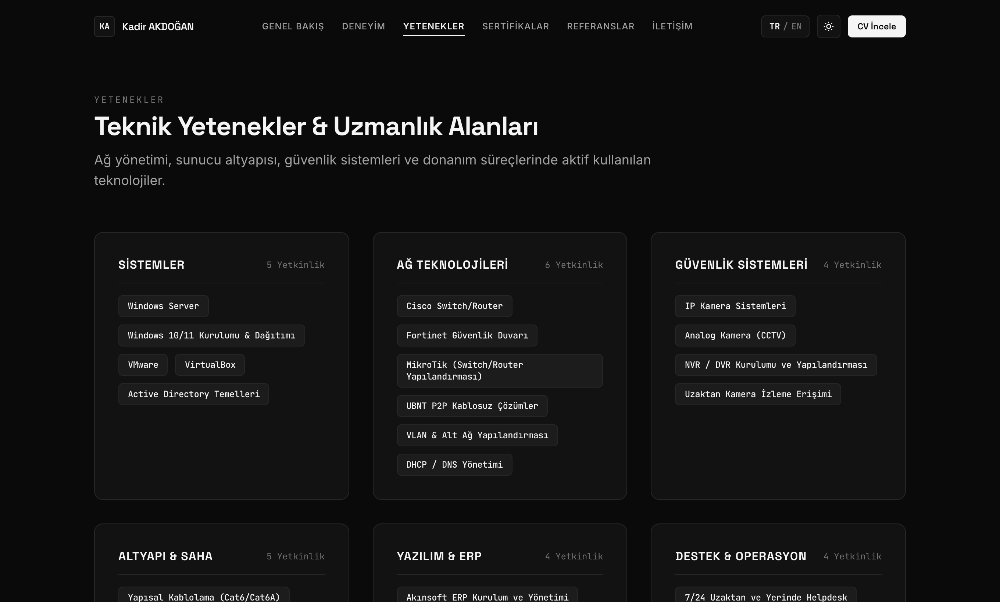
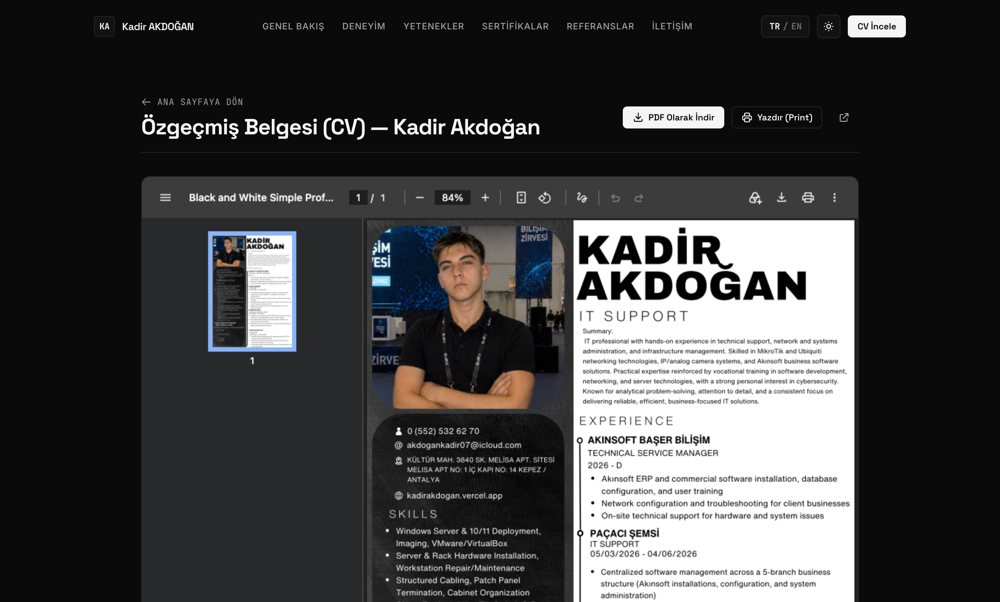
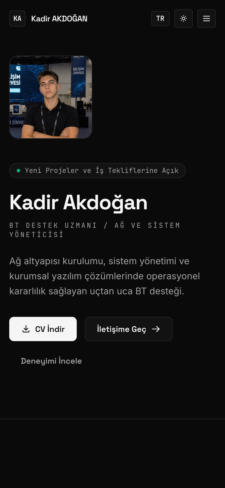
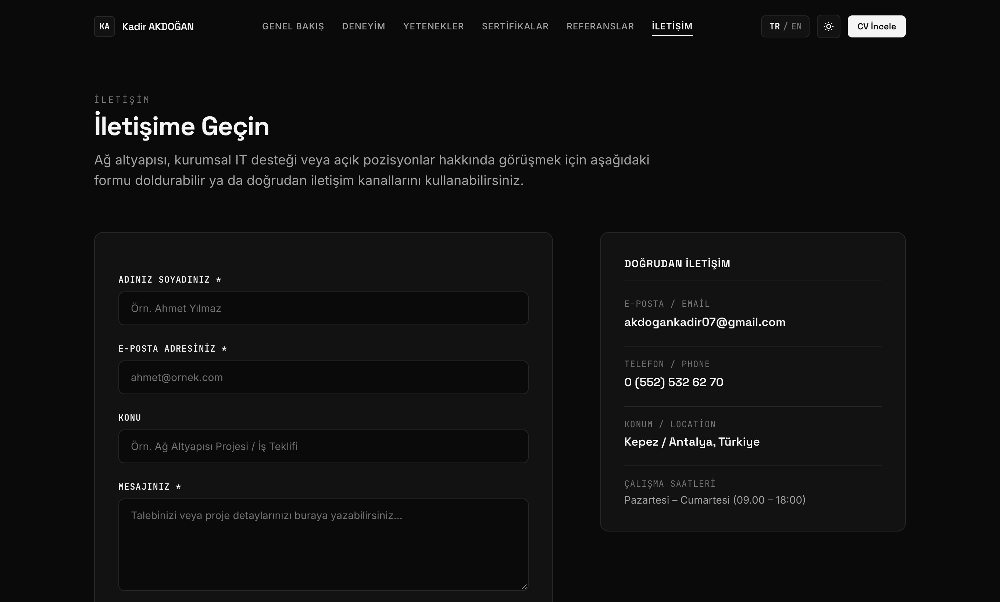

<p align="center">
  
</p>

<p align="center">
  <strong>Modern, kurumsal ve yüksek performanslı kişisel portfolyo &amp; CV web sitesi.</strong><br />
  <em>A modern, enterprise-tier personal portfolio &amp; CV website built for high-performance presentation.</em>
</p>

<p align="center">
  <a href="https://kadirakdogan.vercel.app" target="_blank">
    
  </a>
  <a href="https://kadirakdogan.vercel.app/cv" target="_blank">
    
  </a>
  <a href="https://kadirakdogan.vercel.app/contact" target="_blank">
    
  </a>
</p>

<p align="center">
  
  
  
  
  
  
  
  
</p>

---

## 📌 Genel Bakış / Overview

Bu depo, **Kadir Akdoğan** (BT Destek Uzmanı / Ağ ve Sistem Yöneticisi) için özel olarak tasarlanmış kurumsal düzeydeki kişisel portfolyo, özgeçmiş ve interaktif CV platformunun kaynak kodlarını içerir.

Tasarım felsefesi; Apple ve Microsoft ekosistemlerinin benimsediği **monokrom tipografik hiyerarşi**, **mikro-etkileşimler**, **yüksek kontrastlı karanlık/aydınlık mod** ve **performans odaklı App Router mimarisi** üzerine inşa edilmiştir.

> 🌐 **Canlı Demo**: [https://kadirakdogan.vercel.app](https://kadirakdogan.vercel.app)

---

## 📸 Ekran Görüntüleri / Visual Showcase

### 🌓 1. Ana Sayfa & Tema Desteği (Dark & Light Mode)
Kullanıcının sistem tercihini otomatik algılayan, sıfır gecikmeli ve yüksek kontrastlı monokrom çift tema deneyimi:

| 🌙 Koyu Tema (Dark Mode - Signature Look) | ☀️ Açık Tema (Light Mode) |
| :---: | :---: |
|  |  |

---

### 💼 2. Deneyim & Kariyer Geçmişi (`/experience`)
Ters-kronolojik formatta yapılandırılmış kurumsal pozisyonlar, operasyonel kazanımlar ve her pozisyonda kullanılan spesifik teknolojiler:

<p align="center">
  
</p>

---

### 🛠️ 3. Teknik Yetenek Matrisi (`/skills`)
Sistemler, Ağ Teknolojileri, Güvenlik (CCTV/NVR), Saha & Yapısal Kablolama, Yazılım & ERP (Akınsoft) ve Kullanıcı Destek operasyonlarını kategorize eden dinamik matris:

<p align="center">
  
</p>

---

### 📄 4. Entegre İnteraktif CV Görüntüleyici (`/cv`)
Tarayıcı içinde çalışan gömülü PDF okuyucu (`<object>` ve iframe fallback), doğrudan indirme butonu, yeni sekmede açma ve optimize edilmiş `@media print` baskı desteği:

<p align="center">
  
</p>

---

### 📱 5. Mobil Uyumluluk & İletişim Formu (`/contact`)

| 📱 Mobil Uyumlu Görünüm (Responsive) | 📬 Güvenli İletişim Formu (Resend API) |
| :---: | :---: |
|  |  |

---

## 🌟 Öne Çıkan Özellikler / Key Highlights

- **⚡ Next.js 14 App Router & React 18**: Hızlı ilk sayfa yüklemesi (FCP), optimize edilmiş statik sayfalar ve sunucu taraflı render avantajları.
- **🇹🇷 / 🇬🇧 Çift Dil Desteği (Bilingual Context)**: Sayfa yenilenmesine gerek kalmadan anında Türkçe ve İngilizce içerik değişimi. Tercih `localStorage` üzerinde saklanır.
- **🌓 Kusursuz Tema Sistemi (next-themes)**: Yanıp sönme (FOUC) yapmayan, CSS custom variables tabanlı Dark ve Light mod geçişi.
- **🎨 Framer Motion Animasyonları**: Zarif scroll animasyonları, donanım ivmeli fade-in geçişleri ve `prefers-reduced-motion` erişilebilirlik desteği.
- **✉️ Sunucusuz İletişim Altyapısı (Next.js Serverless Route)**: `/api/contact` üzerinden Resend e-posta servisine doğrudan bağlantı, form doğrulama ve spam avcısı (honeypot field) koruması.
- **🔒 Kurumsal Güvenlik Başlıkları (CSP & HSTS)**: `next.config.mjs` içerisinde yapılandırılmış Content Security Policy, X-Frame-Options (`SAMEORIGIN`), X-Content-Type-Options (`nosniff`).
- **🔍 Arama Motoru Optimizasyonu (SEO & OpenGraph)**: JSON-LD `Person` şeması, otomatik `sitemap.xml`, `robots.txt` ve sosyal medya için OG Image kartları.
- **🖨️ Yazdırma Dostu (Print-Ready)**: Doğrudan `Cmd+P` veya `Ctrl+P` yapıldığında gezinme çubuklarını gizleyen ve salt okunur A4 formatı sunan `@media print` stilleri.

---

## 🛠️ Teknoloji Mimarisi / Tech Stack

| Kategori | Teknoloji / Kütüphane | Açıklama |
| :--- | :--- | :--- |
| **Framework** | Next.js 14 (App Router) | React tabanlı tam kapsamlı üretim çatısı |
| **Dil** | TypeScript | Tip güvenli ve ölçeklenebilir kod tabanı |
| **Stil / CSS** | Tailwind CSS & Vanilla CSS | Katı monokrom tasarım sistemi ve CSS değişkenleri |
| **Animasyon** | Framer Motion | Mikro-etkileşimler ve scroll görünürlük efektleri |
| **Tema** | next-themes | SSR uyumlu tema yönetimi |
| **E-Posta** | Resend API | İletişim formu için sunucusuz e-posta gönderimi |
| **Ekran Yakalama** | Puppeteer-Core | Yüksek çözünürlüklü otomatik ekran görüntüsü üretimi |
| **Dağıtım** | Vercel | Küresel kenar ağında (Edge CDN) sıfır yapılandırmalı yayınlama |

---

## 📁 Proje Dizin Yapısı / Directory Tree

```text
kadir-akdogan-portfolio/
├── assets/                       # GitHub depolama görselleri ve banner'lar
│   ├── banner.svg                # Vektörel dinamik README başlık görseli
│   └── screenshots/              # Retina çözünürlükte ekran alıntıları
│       ├── preview-home-dark.png
│       ├── preview-home-light.png
│       ├── preview-experience.png
│       ├── preview-skills.png
│       ├── preview-certifications.png
│       ├── preview-cv.png
│       ├── preview-contact.png
│       └── preview-mobile.png
├── public/                       # Statik web varlıkları (CDN tarafından sunulan)
│   ├── cv/
│   │   └── kadir-akdogan-cv.pdf  # Güncel profesyonel özgeçmiş PDF belgesi
│   ├── images/
│   │   └── profile.jpg           # Yüksek çözünürlüklü profil fotoğrafı
│   ├── screenshots/              # Genel web erişimli ekran görüntüleri
│   ├── favicon.svg
│   └── og-image.svg
├── scripts/
│   └── capture-screenshots.mjs   # Otomatik ekran görüntüsü alma scripti (Puppeteer)
├── src/
│   ├── app/                      # Next.js App Router Sayfaları ve Endpoint'ler
│   │   ├── api/contact/route.ts  # Resend destekli güvenli iletişim API'si
│   │   ├── certifications/       # Sertifikalar ve eğitim sayfası
│   │   ├── contact/              # İletişim sayfası
│   │   ├── cv/                   # İnteraktif PDF CV önizleme & indirme sayfası
│   │   ├── experience/           # İş deneyimi ve kariyer sayfası
│   │   ├── references/           # Maskeleme korumalı referanslar sayfası
│   │   ├── skills/               # Teknik yetenekler matrisi sayfası
│   │   ├── globals.css           # Monokrom CSS değişkenleri ve baskı stilleri
│   │   ├── layout.tsx            # Root layout, Header, Footer & JSON-LD şeması
│   │   ├── not-found.tsx         # Özel 404 sayfası
│   │   ├── robots.ts             # Robots.txt üreticisi
│   │   └── sitemap.ts            # XML Sitemap üreticisi
│   ├── components/               # Yeniden kullanılabilir React bileşenleri
│   │   ├── ui/                   # Badge, Button, Card, SectionHeading
│   │   ├── Header.tsx            # Yapışkan (Sticky) navigasyon ve geçiş anahtarları
│   │   ├── Footer.tsx            # Kurumsal alt bilgi
│   │   └── ScrollReveal.tsx      # Framer Motion kaydırma kapsayıcısı
│   ├── context/
│   │   └── LanguageContext.tsx   # İki dilli (TR/EN) durum yöneticisi
│   ├── data/                     # İçerik ve veri modelleri
│   │   ├── content.tr.ts         # Türkçe ana metinler
│   │   ├── content.en.ts         # İngilizce tercümeler
│   │   ├── certifications.ts     # Sertifika kayıtları
│   │   └── references.ts         # Referans kayıtları
│   └── lib/
│       └── types.ts              # TypeScript arayüz tanımları
├── next.config.mjs               # CSP güvenlik başlıkları ve Next yapılandırması
├── tailwind.config.ts            # Özel font ve monokrom renk token'ları
└── package.json
```

---

## 🚀 Hızlı Başlangıç / Getting Started

Projeyi yerel makinenizde çalıştırmak için aşağıdaki adımları takip edebilirsiniz:

### 1. Depoyu Klonlayın
```bash
git clone https://github.com/kadirakdogan/my-site.git
cd my-site
```

### 2. Bağımlılıkları Yükleyin
```bash
npm install
```

### 3. Çevre Değişkenlerini Tanımlayın (Opsiyonel)
İletişim formundan e-posta almak istiyorsanız kök dizinde `.env.local` dosyası oluşturun:
```env
RESEND_API_KEY=re_ornek_resend_anahtariniz
```
*(Not: `RESEND_API_KEY` girilmediğinde form geliştirici modunda çalışır ve gönderilen mesajları güvenle sunucu konsoluna kaydeder).*

### 4. Geliştirme Sunucusunu Başlatın
```bash
npm run dev
```
Tarayıcınızdan [http://localhost:3000](http://localhost:3000) adresine giderek siteyi görüntüleyin.

### 5. Yeni Ekran Görüntüleri Oluşturma
Sitede tasarım veya içerik güncellemesi yaptığınızda, README ekran görüntülerini tek komutla otomatik yenileyebilirsiniz:
```bash
npm run screenshots
```

---

## 📝 İçerik Güncelleme Kılavuzu / Content Customization

| Yapılacak İşlem | İlgili Dosya Yolu | Açıklama |
| :--- | :--- | :--- |
| **Yeni İş Deneyimi Ekleme** | `src/data/content.tr.ts`<br />`src/data/content.en.ts` | `experiencePage.items` dizisine yeni pozisyon objesi ekleyin. |
| **Teknik Yetenek Güncelleme** | `src/data/content.tr.ts`<br />`src/data/content.en.ts` | `skillsPage.categories` altında yetenek etiketlerini düzenleyin. |
| **Sertifika Ekleme** | `src/data/certifications.ts` | `certifications` dizisine yeni sertifika veya eğitim kaydı ekleyin. |
| **Referans Ekleme** | `src/data/references.ts` | `references` dizisine isim, kurum, unvan ve telefon bilgisi ekleyin. |
| **CV PDF Belgesini Güncelleme** | `public/cv/kadir-akdogan-cv.pdf` | Yeni PDF dosyanızı bu konuma aynı isimle kaydedin. |
| **Profil Fotoğrafını Değiştirme** | `public/images/profile.jpg` | Yeni portre fotoğrafınızı bu konuma yerleştirin. |

---

## 🌐 Canlı Yayınlama / Deployment (Vercel)

Web sitesi Vercel üzerinde tek tıkla canlıya alınacak biçimde yapılandırılmıştır:

1. Değişikliklerinizi GitHub'a gönderin:
   ```bash
   git add .
   git commit -m "feat: update portfolio content and showcase"
   git push origin main
   ```
2. [Vercel Dashboard](https://vercel.com/new) üzerinden `kadirakdogan/my-site` deposunu bağlayın.
3. Framework Preset otomatik olarak **Next.js** olarak algılanır.
4. **Deploy** butonuna tıklayın. Her `main` dalı güncellemesinde siteniz otomatik olarak derlenip güncellenecektir.

---

## 📬 İletişim / Contact

- **Ad Soyad**: Kadir Akdoğan
- **Unvan**: BT Destek Uzmanı / Ağ ve Sistem Yöneticisi
- **Konum**: Kepez / Antalya, Türkiye
- **E-Posta**: [akdogankadir07@gmail.com](mailto:akdogankadir07@gmail.com)
- **Web Sitesi**: [kadirakdogan.vercel.app](https://kadirakdogan.vercel.app)
- **GitHub**: [@kadirakdogan](https://github.com/kadirakdogan)

---

<p align="center">
  <sub>Tasarım ve mimari: <strong>Kadir Akdoğan</strong> • &copy; 2026 Tüm Hakları Saklıdır.</sub>
</p>
